# Splunk: Exploring SPL v5

## Overview

This TryHackMe hands-on lab focuses on Splunk Search Processing Language (SPL). It provides practical experience in searching, filtering, structuring, and transforming log data to support security investigations.

## Task 1: Introduction

Learned the fundamentals of Splunk Search Processing Language (SPL) and its role in searching and analyzing machine-generated data.

## Task 2: Search & Reporting

Practiced searching indexed events and exploring available fields in Splunk.

**Practical Evidence:**

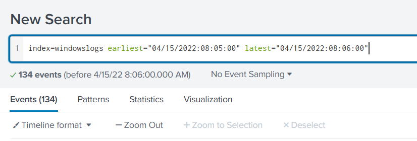

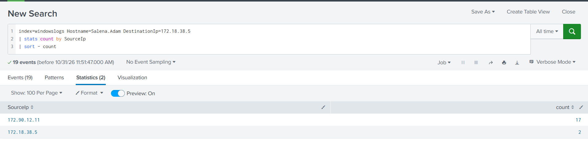

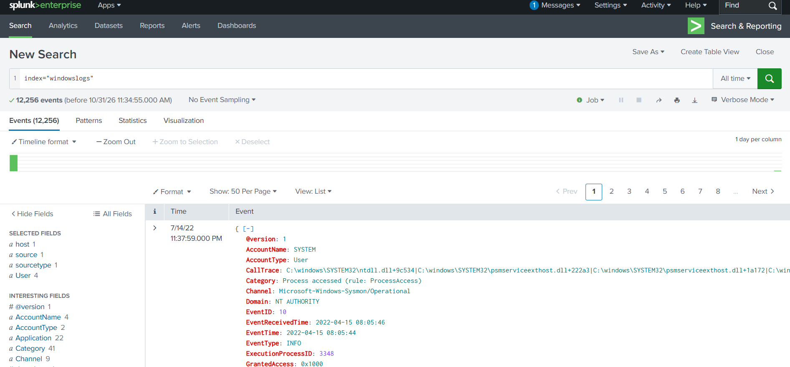

## Task 3: Search Operators

Explored search operators and patterns to make SPL queries more flexible.

**Practical Evidence:**

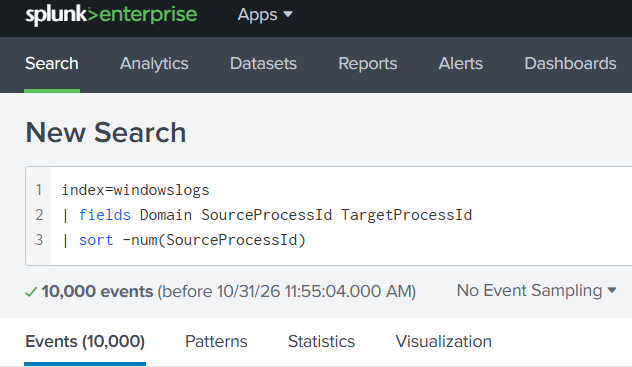

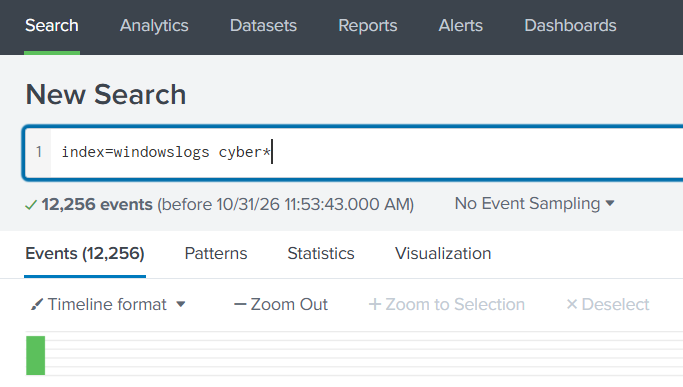

## Task 4: Filtering Results

Practiced narrowing down search results using conditions, counts, and specific values.

**Practical Evidence:**

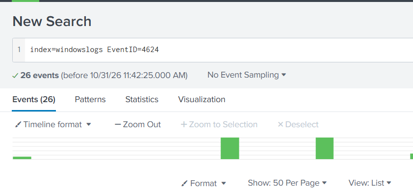

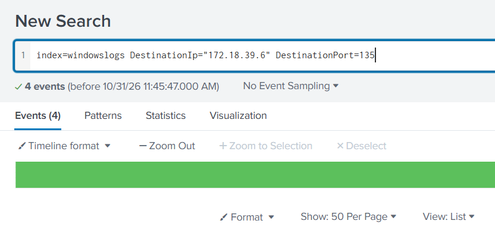

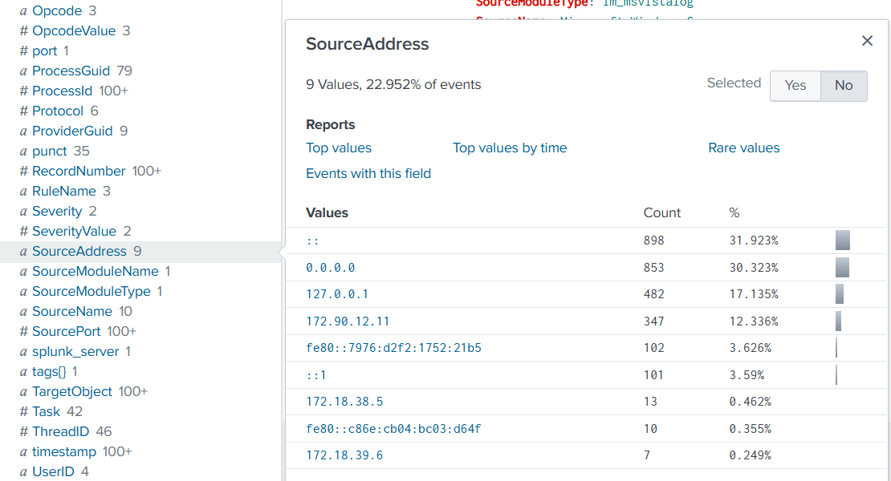

## Task 5: Structuring Results

Learned how to organize and present search results using field selection, renaming, and table formatting.

**Practical Evidence:**

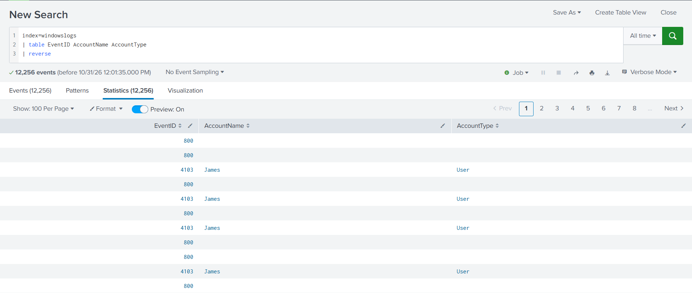

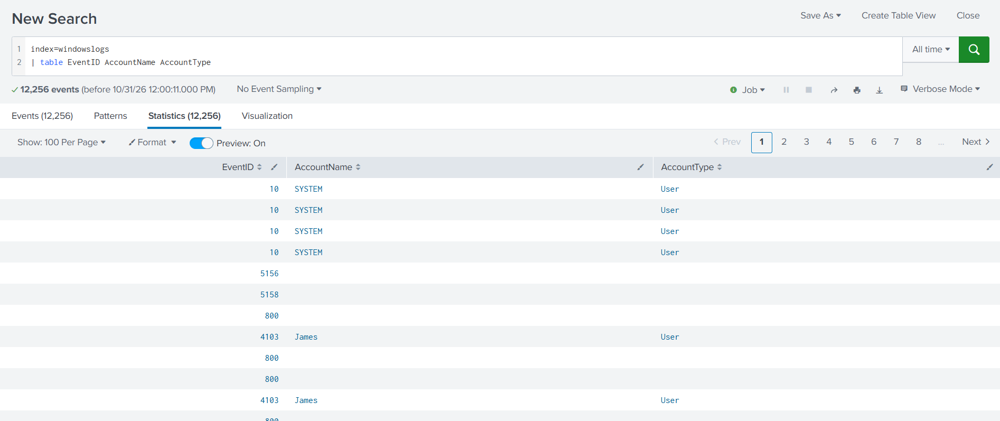

## Task 6: Transforming Commands

Explored SPL commands to transform, summarize, and investigate log data.

**Practical Evidence:**

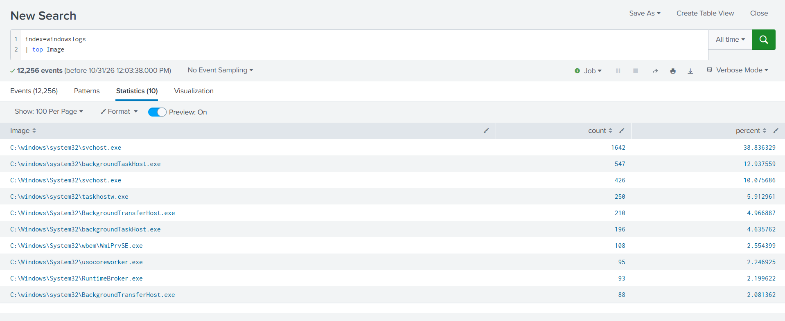

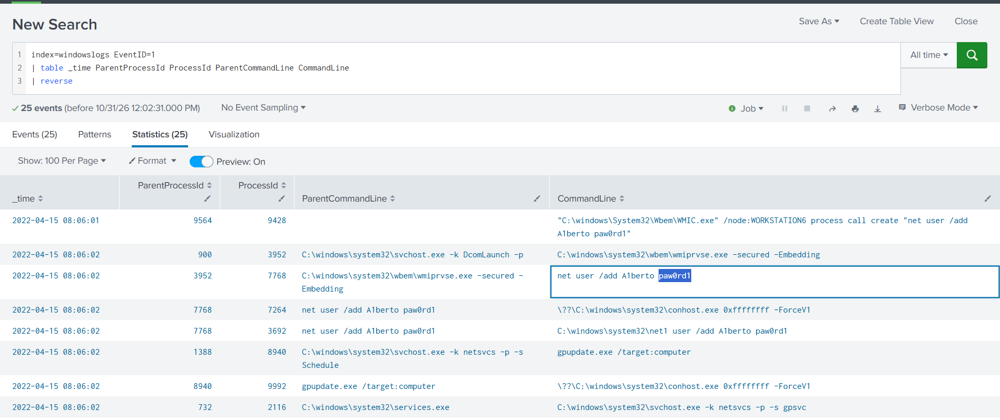

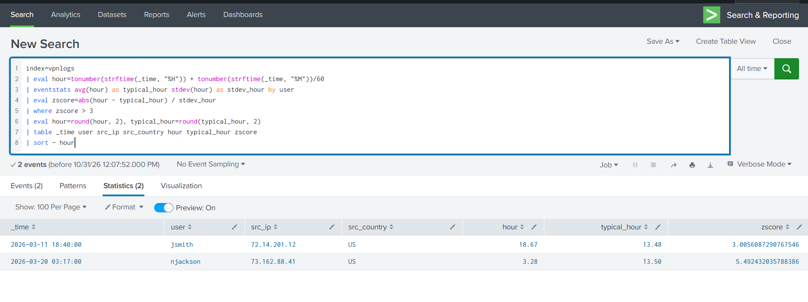

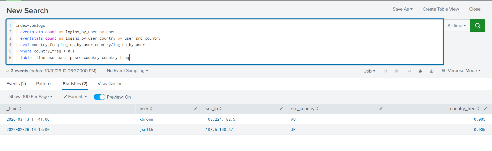

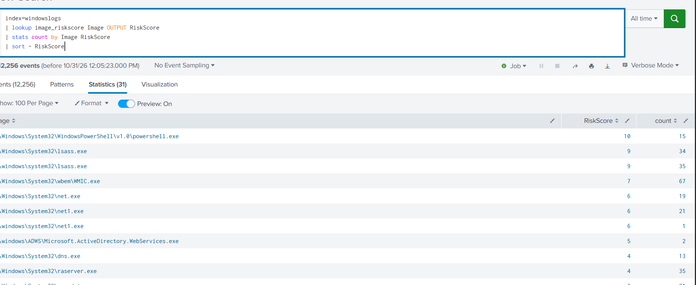

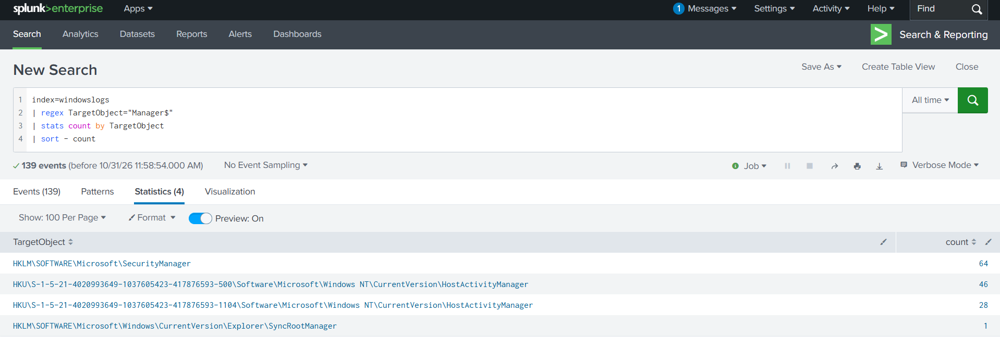

## Task 7: Anomaly Detection

Practiced investigating unusual activity in VPN logs and identifying suspicious login patterns.

Learned how anomaly detection can help security analysts recognize unusual user behavior and investigate potentially suspicious events.

## Task 8: Conclusion

This lab improved my practical understanding of SPL and log analysis using Splunk.

### Key Learning Outcomes

- Searching and analyzing indexed log data.
- Using search operators and filtering conditions.
- Organizing results with fields and tables.
- Applying transforming commands.
- Working with subsearches, lookups, and regular expressions.
- Investigating log activity and understanding anomaly detection.

## Tools & Technologies

- Splunk Enterprise
- Search & Reporting
- Search Processing Language (SPL)
- Windows Logs
- VPN Logs

## Lab Information

**Platform:** TryHackMe

**Room:** Splunk: Exploring SPL v5

**Status:** Completed